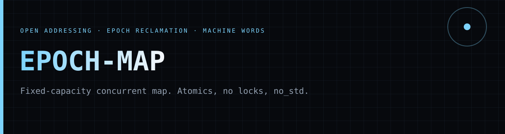

<p align="center">
  
</p>

# epoch-map

**Lock-free concurrent hash map** with quiescent-epoch reclamation.

High-performance, zero-dependency, `no_std` + `alloc` map for workloads where capacity is known up front (caches, session tables, in-process indexes, arenas).

## Why this is powerful

- **100% safe Rust** — no `unsafe`, every slot is three atomics.
- **Zero runtime dependencies**.
- Table allocated **once**; hot path does no allocation.
- Lock-free `get` / `insert` / `remove` / `get_or_insert*` / `update` / `remove_if`.
- Epoch-based reclamation keeps linear-probe chains correct.
- Atomic live/retired counters + load-factor helper.
- Capacity is any power-of-two; MAX_THREADS = 128.
- Designed for the storage layer that sits under payments and ledgers.

## API (high level)

```rust
use epoch_map::EpochMap;

let map = EpochMap::<u64, u64, 4096>::new();

map.enter(0);
map.insert(1, 100);
assert_eq!(map.get(&1), Some(100));
assert!(map.contains_key(&1));
assert_eq!(map.get_or_insert(2, 200), 200);
assert_eq!(map.get_or_insert_with(3, || 300), 300);
assert_eq!(map.update(&1, |v| v + 1), Some(101));
assert_eq!(map.remove_if(&2, |&v| v == 200), Some(200));
assert_eq!(map.len(), 2);
assert!(map.load_factor() < 1.0);
map.exit(0);

// Reclaim tombstones when all threads are quiescent
let freed = map.try_advance_and_reclaim();
```

`insert` panics on full table; `try_insert` returns `Err(MapFull)`.

## Semantics & safety

- Slot lifecycle: `EMPTY → BUSY → OCCUPIED → TOMBSTONE → EMPTY`.
- A key is written into a slot exactly once. `remove` only changes state to tombstone; re-insert of the same key revives that slot.
- Tombstones of *other* keys are not reused until `try_advance_and_reclaim` runs under full quiescence. Keep load factor well below 1.0.
- Reclamation walks backwards and only frees a tombstone when the next slot is `EMPTY`, preserving probe sequences.
- Skipping `enter`/`exit` is memory-safe but can cause a concurrent reclaim to temporarily “hide” a key.

## Build & test

```bash
cargo test --release --lib
cargo run --example p99 --release   # latency percentiles
```

## Performance notes

Designed for low-latency concurrent access. Under moderate load factor the critical path is a handful of atomic loads/stores + short linear probe. The fixed-capacity + no-allocation design wins when you can size the table correctly.

## License

MIT
